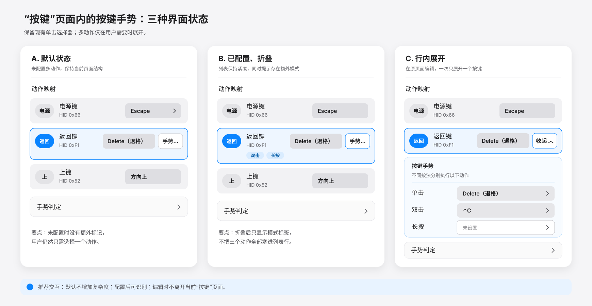
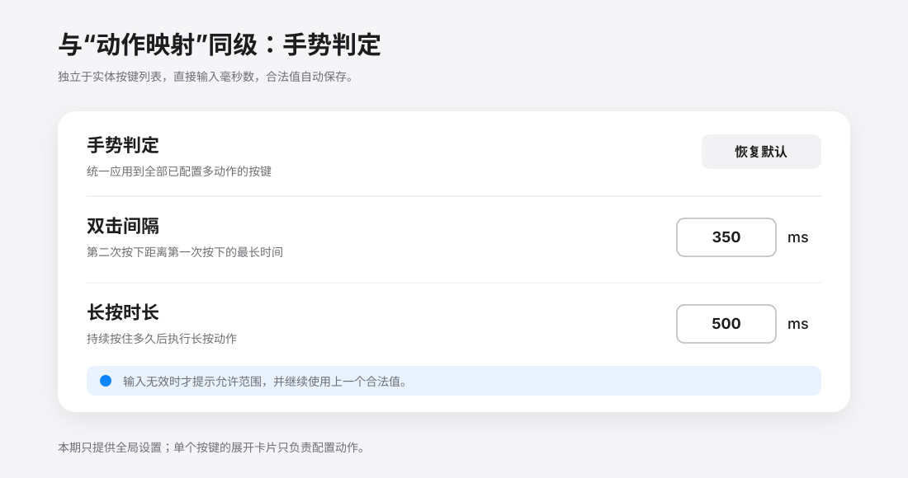

# 多动作按键设计

多动作按键让一个实体按键根据单击、双击和长按执行不同动作，以扩展遥控器有限的按键数量。功能继续位于现有“按键”页面，不增加新的一级页面。

## UI

未配置手势时，每个按键行仍直接显示并编辑单击动作。点击“手势…”后，在当前行下方展开单击、双击和长按三个动作槽，一次只展开一个按键。折叠后使用“双击”“长按”标记提示已配置的手势。

“动作映射”和“手势判定”是同一设置容器内的两个同级区块。手势判定提供设备全局的双击间隔和长按时长；页面支持纵向滚动。

时间字段只接受数字。结束编辑时将越界值修正到合法范围，清空则恢复当前保存值；按 Enter 或点击“保存”后提交，并回显最终采用的值。

## 手势语义

### 只配置单击

- 按下后立即执行并保持动作，松开时释放，不等待手势窗口。
- 键盘按键、自定义快捷键和音量动作支持保持重复；静音和播放/暂停不重复；鼠标右键和打开应用执行一次。
- 快速连续短按逐次执行。

### 配置双击

- 第一次短按后等待双击窗口。
- 在窗口内完成第二次短按时，只执行双击动作。
- 窗口结束仍没有第二次按下时，执行单击动作。

### 配置长按

- 在长按阈值前松开时执行单击动作。
- 持续按住超过阈值时，按下并保持长按动作，实体键松开时释放。
- 保持期间发送按键重复事件，不循环发送完整的按下和释放。
- 短按一次后快速再次按住同一按键时，按下并保持单击动作。这为已配置长按的按键保留单击重复能力。

### 同时配置双击和长按

- 两次短按执行双击动作。
- 第一次按住超过长按阈值后保持长按动作。
- 第一次短按后再次按住时保持单击动作。
- 一次普通短按执行单击动作。

语音键继续使用原有的按住说话、Fn 映射和双击桥接逻辑，不进入通用手势状态机。

## 判定时间

| 参数 | 默认值 | 可调范围 |
| --- | ---: | ---: |
| 双击间隔 | 350 ms | 200–600 ms |
| 长按时长 | 500 ms | 300–1500 ms |

长按时长始终至少比双击间隔大 50 ms。只修改长按且发生冲突时，优先保留长按并降低双击间隔；只修改双击或同时修改两项且发生冲突时，优先保留双击并提高长按时长。

每轮手势开始时固定动作映射和判定时间，设置修改从下一轮手势生效。窗口采用半开区间：第二次按下早于截止时刻才属于当前序列；达到或超过截止时刻时开始新序列，避免输入回调与定时回调的执行顺序改变结果。

## 保持、重复与固件报告

普通单键和已配置手势的按键共用同一状态机、Runtime Coordinator 和输出流程。RC003 在保持实体键时可能用短暂的释放/再次按下报告表达固件重复：

- 普通短按在松开时立即释放，避免将快速独立点击合并。
- 按住达到 350 ms 重复等待后，使用 120 ms 释放宽限合并固件重复轮次。
- 主动重复间隔为 100 ms，是否重复由配置动作决定，不再使用实体按键白名单。
- 停止、设备断开、桥接关闭或权限失效时取消定时任务并尽力释放所有保持动作。

## 兼容模式的原生输入屏蔽

独占读取不可用时，应用在当前 RC003 的设备服务上为所有非语音键写入目标为 0 的 `UserKeyMapping`，使系统在原生电源、媒体键等语义之前丢弃事件。原始 HID 报告仍由应用读取并执行用户配置的动作，因此电源、菜单、TV 等按键遵循相同规则，且不会按键码拦截其他实体键盘。

`RemoteButtonNativeMapper` 负责该映射的安全生命周期：

- 只接受当前 RC003 HID 身份和 LocationID 唯一匹配的服务。
- 写入前保存原始映射及服务 RegistryID，写入后读回验证；无法确认成功时停止自定义注入。
- 恢复时只撤销仍等于本应用写入值的映射，保留无关映射及第三方后续修改。
- 退出、停用、设置重启、权限失效和设备移除时恢复；重新连接后对新服务重新应用。
- 进程异常退出后由下次启动使用持久化记录恢复；设备断连会销毁设备局部映射。

语音键保留既有 F5/Fn 映射及 session 事件处理，不由普通键映射器接管。

## 打开应用动作

单击、双击和长按均可选择“打开指定应用…”。选择器只接受有效 `.app` 包，保存应用路径、Bundle ID 和显示名称。执行时优先使用保存路径；应用移动后按 Bundle ID 重新定位，复用已有实例并激活。无法定位或启动时记录日志并播放提示音。

详细行为见 [打开指定应用](open-application.md)。

## 配置兼容

- 升级后，V1/V2 中已有动作自动成为对应按键的单击动作，双击和长按默认未设置。
- V3 保存完整手势和打开应用动作。
- 为旧版本保留的 V2 投影只写入其支持的单击动作；打开应用投影为禁用，避免旧版无法解码整份配置。
- “恢复默认”恢复默认单击动作，并清除双击和长按动作。
- 全局判定时间独立持久化并在加载时规范化。

## 模块边界

| 模块 | 职责 |
| --- | --- |
| `SettingsView` / `AppSettings` | 编辑、校验、迁移和持久化动作及判定时间 |
| `MultiActionButtonGesture` | 纯手势状态机，输出动作意图 |
| `MultiActionRuntimeCoordinator` | 运行时、配置快照、截止时间、固件重复合并与重置 |
| `HIDRemoteMonitor` | 设备边缘路由、权限门禁、平台动作交付和清理 |
| `KeyboardInjector` | 键盘、系统键、鼠标和应用动作的发送、保持及释放 |
| `RemoteButtonNativeMapper` | 兼容模式中非语音键的设备级原生输入屏蔽及恢复 |

Coordinator 的调用、定时回调和输出交付共用同一串行执行上下文；生产环境使用主线程。状态机和 Coordinator 不依赖 macOS 权限 API，HID 交付边界在每个新动作执行前复查实时权限；已有保持动作的释放继续尽力交付。

## 验证重点

1. 未配置手势的按键即时执行，按动作能力决定是否重复。
2. 单击、双击、长按只执行对应动作，截止时刻不受回调顺序影响。
3. 长按动作保持到实体键松开，重复事件中没有额外释放。
4. 短按后再次按住时保持单击动作。
5. 修改判定时间后从下一轮按键生效，重启后仍保留。
6. 恢复默认会恢复单击映射并清除额外手势。
7. 设备映射的写入、读回、恢复、失败重试和第三方修改保留符合生命周期契约。
8. 语音键按住说话与双击切换桥接不受影响。
